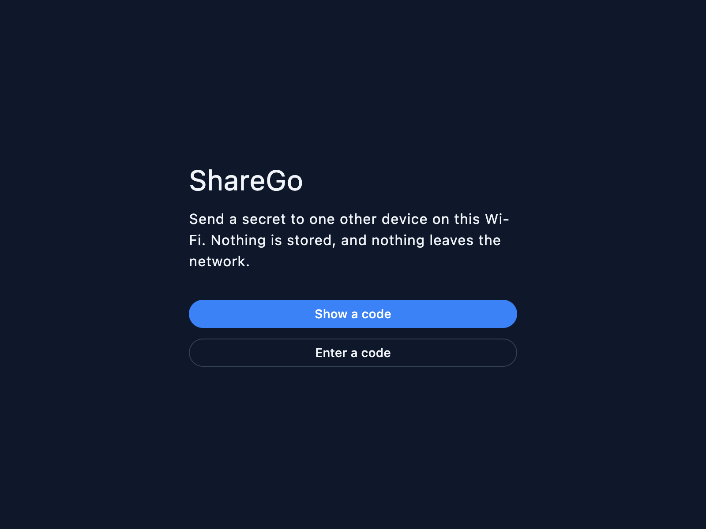
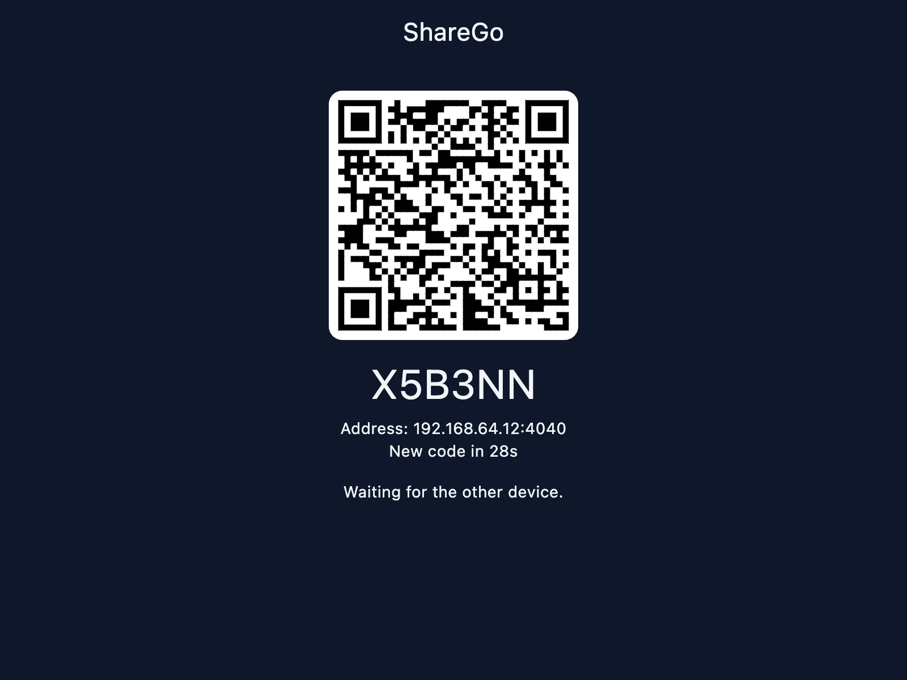
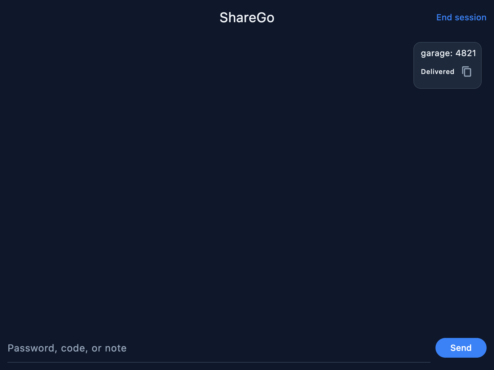
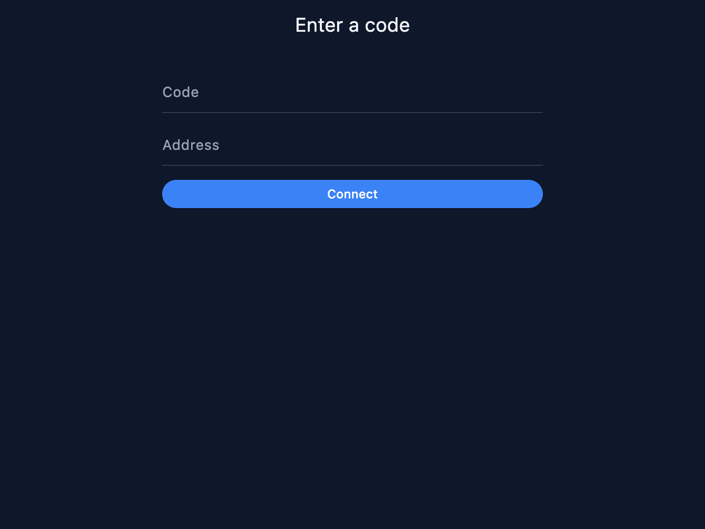

<p align="center">
  
</p>

<h1 align="center">ShareGo</h1>

<p align="center">
  Hand a password, a code, or a note to one other device on the same Wi-Fi.<br>
  Encrypted on the device. Nothing stored. Nothing sent to a server.
</p>

<p align="center">
  <a href="https://github.com/MehdiMamas/ShareGo/releases/latest"><strong>Download the latest release</strong></a><br>
  <a href="docs/CODE_SIGNING.md">Code signing policy</a> · <a href="docs/PRIVACY.md">Privacy policy</a>
</p>

<p align="center">
  
  
  
</p>

## Download

| File | What to do |
| --- | --- |
| [ShareGo-windows-setup.exe](https://github.com/MehdiMamas/ShareGo/releases/latest/download/ShareGo-windows-setup.exe) | Run the installer. No admin rights needed. ShareGo updates itself from then on. Allow it on private networks when Windows asks. |
| [ShareGo-windows.msi](https://github.com/MehdiMamas/ShareGo/releases/latest/download/ShareGo-windows.msi) | Installs for all users, for admins and deployment tools. Update it with the next MSI. |
| [ShareGo-windows.zip](https://github.com/MehdiMamas/ShareGo/releases/latest/download/ShareGo-windows.zip) | Unzip and run `ShareGo.exe`, no install. |
| [ShareGo-macos.dmg](https://github.com/MehdiMamas/ShareGo/releases/latest/download/ShareGo-macos.dmg) | Open the disk image and drag ShareGo to Applications. |
| [ShareGo-android.apk](https://github.com/MehdiMamas/ShareGo/releases/latest/download/ShareGo-android.apk) | Install the APK. |
| [ShareGo-linux.tar.gz](https://github.com/MehdiMamas/ShareGo/releases/latest/download/ShareGo-linux.tar.gz) | Unpack and run `ShareGo`. |
| [ShareGo-unsigned.ipa](https://github.com/MehdiMamas/ShareGo/releases/latest/download/ShareGo-unsigned.ipa) | Sideload with AltStore or Sideloadly. |

The desktop apps check GitHub for a new release when they start and every 6 hours. On Windows (setup exe) the update installs with one click and ShareGo reopens. On macOS the new DMG is downloaded and opened; drag ShareGo to Applications to replace the old copy. Both Windows installers let you turn the check off; see the [privacy policy](docs/PRIVACY.md).

Windows releases are signed through SignPath; see the [code signing policy](docs/CODE_SIGNING.md). Until a signed release is out, SmartScreen may warn on first run. Choose **More info**, then **Run anyway**.

## How a transfer works

1. On the device that will receive, tap **Show a code**. It shows a QR code, a 6-character code, and an address. They change every 30 seconds until someone connects.
2. On the other device, tap **Enter a code**. Scan the QR code, or type the code. If the code is not found on the network, type the address shown on the first device.
3. Both screens show the same number. Compare it, then tap **Approve** on the receiving device. A QR scan also checks the public key in the code.
4. Type the secret and send it. **End session** closes the connection and clears the messages.

Exactly two devices. A third device cannot join. Start a new code for a new pair.

<p align="center">
  
</p>

## What stays on the Wi-Fi

- The two devices talk over TCP on the local network. There is no cloud, relay, or signup.
- Each code uses a new X25519 key. The message key is derived with HKDF-SHA256 and the text is encrypted with XChaCha20-Poly1305.
- Keys and messages are wiped when the session ends. Nothing is written to disk.

## Develop

Flutter stable, plus the SDK for the platform you run. See [docs/BUILDING.md](docs/BUILDING.md).

```bash
flutter pub get
flutter test
flutter run
```

- [Protocol](docs/PROTOCOL.md)
- [Architecture](docs/ARCHITECTURE.md)
- [Threat model](docs/THREAT_MODEL.md)
- [Security policy](SECURITY.md)
